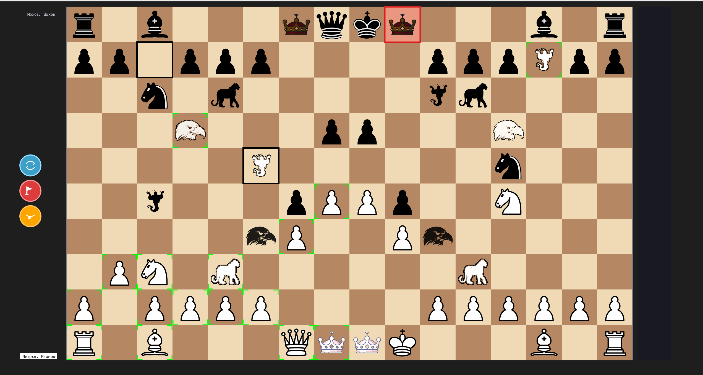

# chess

Сетевые шахматы для локальной сети.

Многопользовательское клиент-серверное приложение с терминальным сервером и десктопными графическими клиентами.

Сетевой TCP стек — асинхронный на сервере и клиенте: неблокирующие сокеты + epoll для линукса, kqueue для винды.

Графический стек — CPU-рендеринг.
Клиенты работают на винде, маках, линуксе - везде, где есть минимальная графическая оболочка.
Всё — чистый Rust, без GPU, без системных GUI-тулкитов (Qt/GTK).
Собирается под Linux/Windows/macOS без дополнительных зависимостей.

На сервере хранятся правила, текущее состояние каждой игры, часы, матч-мейкинг, ничьи/сдачи, история.
Клиент отправляет ходы, получает состояние и рисует доску с фигурами, управляет вводом.
Для тестирования есть боты.

Есть классические шахматы 8х8, есть шахматы 10х10, есть командные шахматы двое на двое 16х10.
В шахматах 10х10 и 16х10 добавлены новые фигуры, правила для них можно почитать тут: https://github.com/sbsoft-cmd/chess_10x10.

Подробную документацию смотрите в вики.

В командных шахматах 16х10 изменены базовые концепции.
В команде два игрока, у каждого свой набор фигур, стандартные + нестандартные, включая принца.
Сначала ходят двое белых игроков подряд, потом двое черных, и так по кругу.
Цель игры - коронация принца. Коронация - это попадание принца на последнюю горизонталь.
В стартовой позиции один принц стоит слева от королевы, второй справа от короля.
Принц бессмертен, т.е. он может быть многократно срублен, каждый раз он помещается на запасное поле, откуда возвращается на доску, каждый раз задерживаясь на запасном поле все дольше. Пока принца нет, его хозяин выключается из игры. Принц ходит как король и как конь одновременно и не может рубить. Принц может рокироваться с любой своей фигурой, если она стоит рядом. Король становится обычной фигурой как все остальные и ему нельзя поставить мат.

В окне настроек есть 3 поля для ввода, из которых только Имя обязательно:
1. Имя
2. Соперник
3. Союзник

Если второе и третье поле пустые, сервер найдет вам случайных соперников и партнеров для командной игры, если те нажали те же кнопки, что и вы.
Если вы набрали соперника, то сервер может соединить вас только с ним в качестве соперника, если он в игре.
Если вы набрали союзника, то сервер обьединит вас только с ним в одной команде, для этого также должна быть нажата кнопка 16х10.

Скриншот командной игры 16х10

